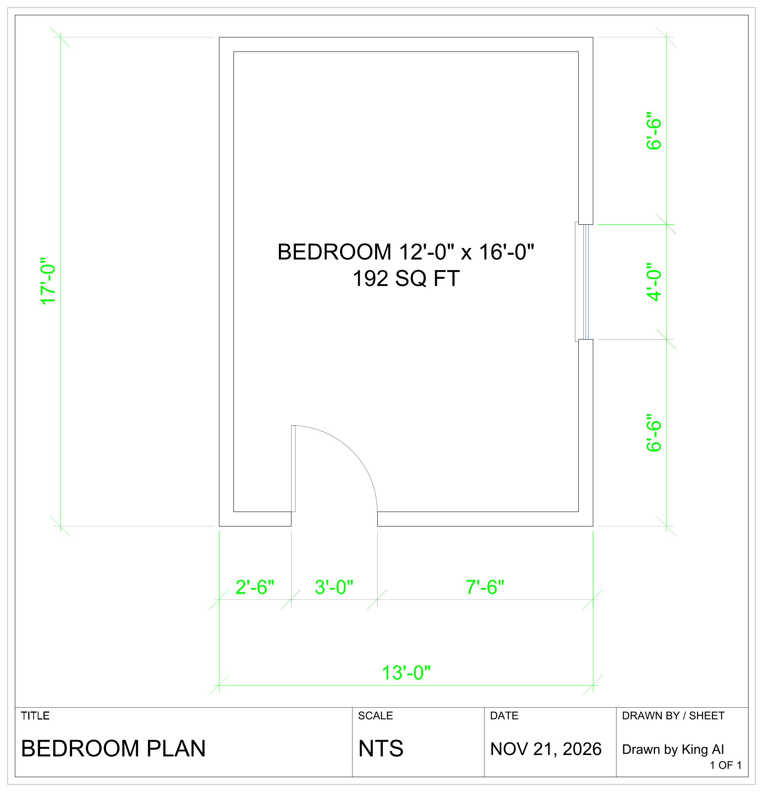
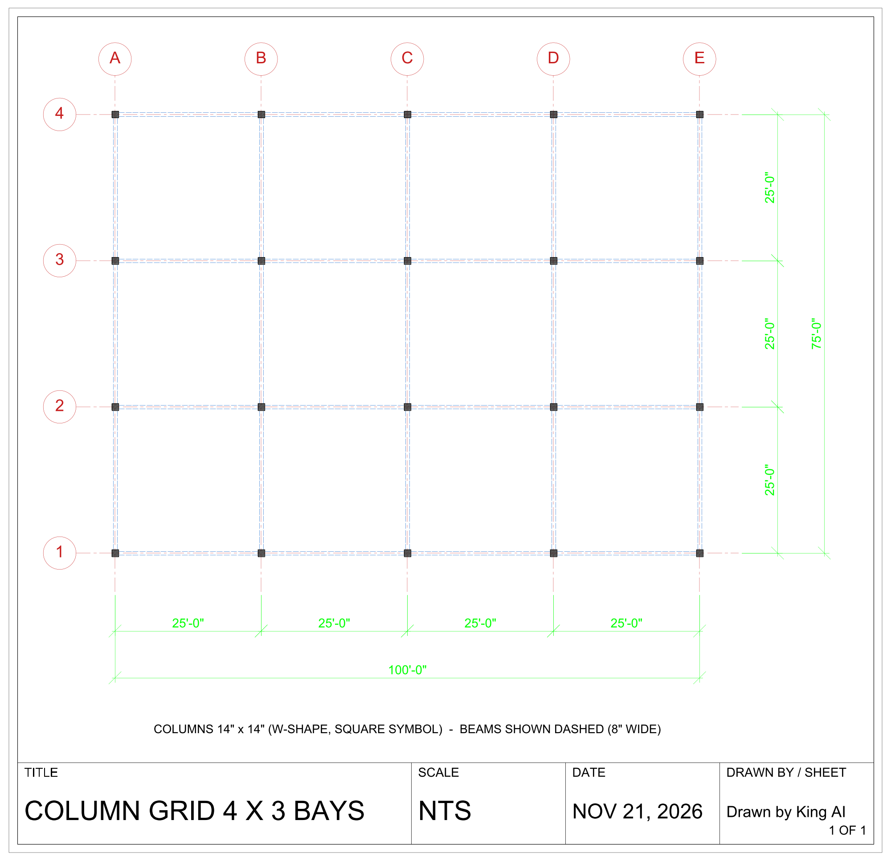
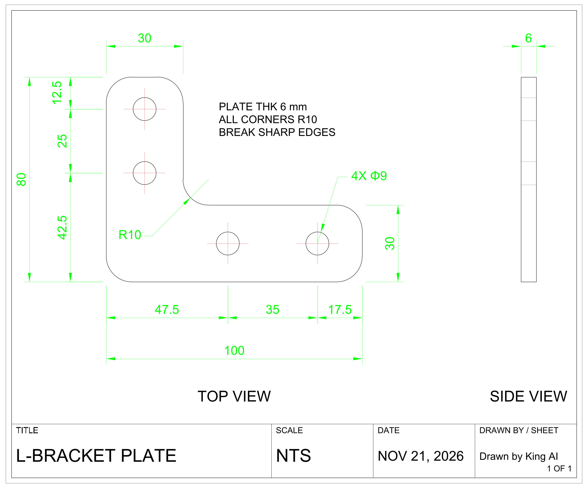

# cadkit / cad-mcp

Turn a plain-language or JSON request into a real DXF drawing plus PNG and PDF renders. No AutoCAD licence, no GUI app:
pure Python on top of [ezdxf](https://ezdxf.mansfield-online.com/) and matplotlib. Includes an MCP server so Claude (or any MCP
client) can draw for you.

> **Honest note:** this is a drafting aid. Its output is not stamped, sealed or code-checked engineering or architectural
> drawing. Have a licensed professional verify anything that gets built, permitted or manufactured.

## Need it drawn for you?

$49 per simple 2D drawing (DXF + PDF, 2 business days): https://buy.stripe.com/6oUaEQbTNb4E87EdqX0x52t

A room or floor plan, column grid, or flat part, drafted from your dimensions or sketch. Drafting aid, not a stamped engineering drawing.

### Samples

| Room plan | Column grid | Bracket |
|---|---|---|
|  |  |  |

* DXF is saved as **R2010 (AC1024)**: opens in AutoCAD, LibreCAD, FreeCAD, QCAD.
* Real entities: LINE, LWPOLYLINE, CIRCLE, ARC, MTEXT, HATCH and real **DIMENSION** entities (dimstyles `ARCH-FTIN` for
  feet-inches, `MECH-MM` for millimetres), organised on named layers with colours and linetypes.
* Every drawing gets a title block: title, scale, date (US Central), "Drawn by King AI".

## Install

```bash
pip install ezdxf matplotlib mcp            # add --user (and --break-system-packages on PEP 668 systems) if needed
python3 -m pytest -q tests                  # optional
```

## Use

```bash
python3 cli.py build samples/specs/room-12x16.json --out out/       # DXF + PNG + PDF + audit
python3 cli.py audit out/room-12x16.dxf                             # ezdxf audit + entity counts per layer
python3 cli.py render out/room-12x16.dxf --out out/
```

Python:

```python
from cadkit import room_plan, column_grid, bracket_part, render_dxf, audit_file
d = room_plan(12, 16, 6, doors=[{"wall": "south", "offset_ft": 2, "width_ft": 3}],
              windows=[{"wall": "east", "offset_ft": 6, "width_ft": 4}], name="BEDROOM")
d.save("bedroom.dxf"); render_dxf("bedroom.dxf"); print(audit_file("bedroom.dxf"))
```

### Spec format

```json
{"type": "room_plan", "name": "BEDROOM", "width_ft": 12, "length_ft": 16, "wall_thickness_in": 6,
 "doors": [{"wall": "south", "offset_ft": 2, "width_ft": 3, "swing": "in", "hinge": "start"}],
 "windows": [{"wall": "east", "offset_ft": 6, "width_ft": 4}]}
{"type": "column_grid", "bays_x": 4, "bays_y": 3, "spacing_x_ft": 25, "spacing_y_ft": 25, "column_size_in": 14}
{"type": "bracket", "length_mm": 100, "height_mm": 80, "leg_width_mm": 30, "thickness_mm": 6, "hole_dia_mm": 9, "fillet_r_mm": 10}
{"units": "mm", "title": "PLATE", "layers": [{"name": "PART", "color": "red", "linetype": "DASHED"}],
 "entities": [{"type": "rectangle", "corner1": [0, 0], "corner2": [60, 40], "layer": "PART"},
              {"type": "dimension", "p1": [0, 0], "p2": [60, 0], "offset": -10, "kind": "horizontal"}]}
```

Generic entity types: `line`, `rectangle`, `polyline`, `circle`, `arc`, `text` (MTEXT), `dimension`
(`aligned|horizontal|vertical`), `hatch`. Bad input raises a precise error such as
`doors[0] (9 ft + 3 ft wide) does not fit the south wall (10 ft clear)`. `units: "in"` is architectural (coordinates in inches,
dimensions shown as feet-inches); `"mm"` is mechanical.

Room plans: `offset_ft` is measured along the wall from its interior start corner (south/north from the left, east/west from
the bottom). Overall dimensions run to the outside of the walls.

## MCP server

Tools: `create_drawing`, `add_entities`, `draw_room_plan`, `draw_column_grid`, `draw_bracket`, `render_drawing`,
`audit_drawing`, `list_layers`. Files go to `$CADKIT_OUT` (default `./cad-output`).

Claude Code:

```bash
claude mcp add cadkit -e CADKIT_OUT=$HOME/cad-output -- python3 /path/to/cad-mcp/server.py
```

Claude Desktop (`claude_desktop_config.json`):

```json
{"mcpServers": {"cadkit": {"command": "python3", "args": ["/path/to/cad-mcp/server.py"],
                           "env": {"CADKIT_OUT": "/Users/you/cad-output"}}}}
```

Works with `mcp` 1.x (`FastMCP`) and 2.x (`MCPServer`).

## Known limits

* Title-block scale is a label (default `NTS`); renders are fit-to-image, not plotted to a true paper scale.
* The PNG/PDF renderer draws the diameter sign as a Greek phi (the DXF keeps the real diameter sign) because the matplotlib
  text-outline path fills that glyph solid.
* Architectural dimension text is written as an explicit feet-inches string (the ezdxf renderer ignores DIMLUNIT); the DIMENSION
  entities themselves carry the real measurement and the `ARCH-FTIN` dimstyle.
* No walls hatching, stairs, furniture, 3D, or layouts/paper space.

---
Built by King AI — https://usekingai.com
